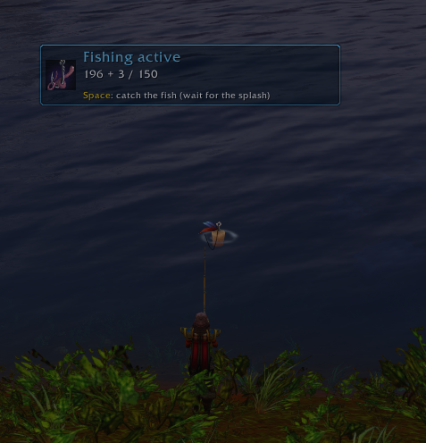

# FishToggle

Ett World of Warcraft-tillägg som låter dig växla mellan dina vanliga vapen och ett fiskespö via en knapp vid minikartan. Du kan också kasta och fånga fisk med mellanslag.

## Exempel

## Installation

1. Lägg mappen `FishToggle` i din spelklients `Interface/AddOns/` (exempelvis `_forever_/Interface/AddOns/FishToggle/`).
2. Kontrollera att `FishToggle.toc` och `FishToggle.lua` ligger direkt i mappen.
3. Starta om spelet om tillägget installerades medan spelet var igång och aktivera **FishToggle** i tilläggslistan.

Tilläggets TOC-fil anger interface-version `16001`. Kompatibilitet med andra klientversioner är inte verifierad. Inga externa tillägg krävs.

## Användning

Ha Fishing inlärt och ett fiskespö i väskorna. Bär dina vanliga vapen första gången så att tillägget kan komma ihåg dem.

| Kontroll | Funktion |
| --- | --- |
| Vänsterklick på minikartsknappen | Utrusta fiskespö eller återställ dina sparade vapen. |
| Högerklick på minikartsknappen | Kasta Fishing. |
| Dra minikartsknappen | Flytta den runt minikartan. |
| Mellanslag med fiskespö utrustat | Kasta Fishing, eller interagera med flötet under pågående fiske. |
| Dra informationsrutan | Flytta rutan som visas när mellanslag används för fiske. |

Om du har flera fiskespön väljs det med högst föremålsnivå i väskorna, inte nödvändigtvis det med högst fiskebonus. Vapnen för huvudhand och andra hand sparas per karaktär och finns kvar efter utloggning.

### Fiska med mellanslag

Funktionen är aktiverad från början:

1. Vänsterklicka på minikartsknappen för att utrusta fiskespöet.
2. Tryck på mellanslag för att kasta.
3. Vänta tills det nappar och tryck på mellanslag igen för att interagera med flötet.
4. Vänsterklicka på knappen för att återställa vapnen när du är klar.

Fiskeläget aktiverar också spelets kugghjulsikon över flötet när spelet väljer det som interaktionsmål. Ikonen följer flötet i världen. Den visar att du kan interagera, inte att det har nappat. Eftersom detta är spelets egen interaktionsmarkering kan den även visas över andra interaktionsmål i närheten.

Informationsrutan **Fishing active** visas när mellanslag är kopplat till fiske. Den pulserar under pågående kast; pulseringen betyder inte att det har nappat. Du behöver själv tajma fångsten.

Rutan visar också `grundskill + bonus / zonens fiskenivå`, exempelvis `150 + 25 / 225`. Värdena uppdateras medan rutan visas, även när bonusar ändras eller löper ut. Zonens nivå är ett riktvärde för säker fångst enligt Classic-data, samma som i OpenMap för Forever, inte minimikravet för att kasta. Enskilda vatten och Forevers egna områden kan avvika. Okända värden visas som `?`.

När fiskespöet tas av, eller funktionen stängs av, återställs mellanslag till sin vanliga bindning. Ändringar av bindningen som blockeras under strid väntar tills striden är slut.

## Kommandon

| Kommando | Funktion |
| --- | --- |
| `/fishtoggle` | Visa kommandohjälp. |
| `/fishtoggle space` | Slå på eller av fiske med mellanslag. |

## Sparade inställningar

- `FishToggleDB`: minikartsknappens placering, informationsrutans placering och inställningen för mellanslag.
- `FishToggleCharDB`: karaktärens sparade vapen.

När mellanslagsfunktionen används justerar tillägget tillfälligt `softTargetInteract`, `SoftTargetInteractArc` och `SoftTargetInteractRange` för att kunna nå flötet, samt `SoftTargetIconInteract` och `SoftTargetIconGameObject` för att visa kugghjulet. Tidigare värden sparas och återställs när funktionen avaktiveras eller fiskespöet tas av. Stäng därför av funktionen innan du inaktiverar själva tillägget om du vill återställa dessa värden.

## Felsökning

- **Inget fiskespö hittas:** lägg ett fiskespö i dina vanliga väskor.
- **Vapnen återställs inte:** utrusta dina vanliga vapen manuellt en gång så att tillägget lär sig dem. Se till att de finns i väskorna när du vill byta tillbaka.
- **Mellanslag fångar inte fisken:** kontrollera att funktionen är på, att du har fiskespöet utrustat och att flötet är framför dig inom räckhåll. Tryck först när det nappar.
- **Knappen går inte att flytta eller bindningen uppdateras inte:** försök igen när du har lämnat strid.

## Version

Version **1.0.0**, skapad av **Per**.
